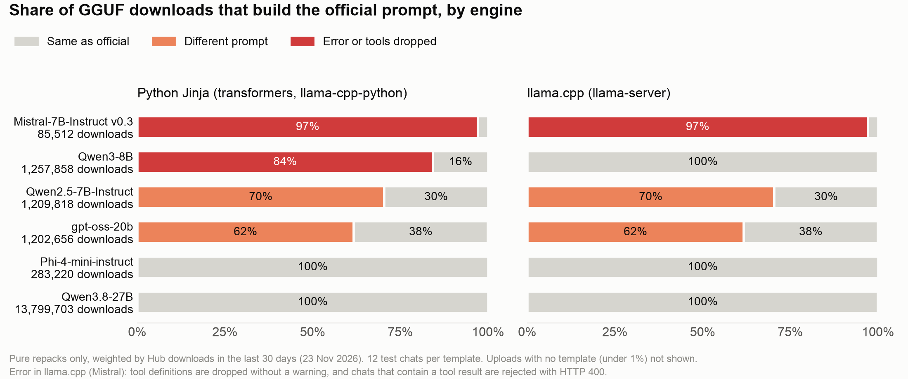
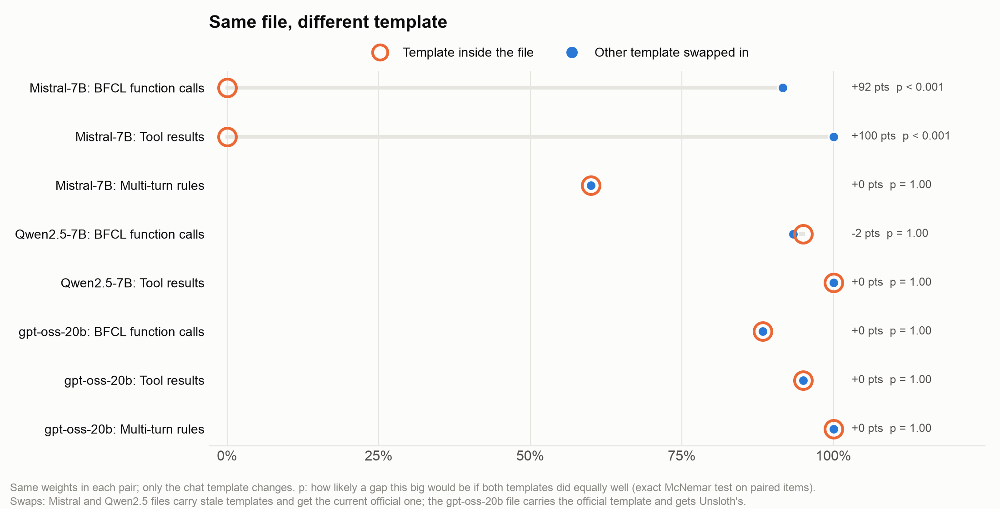

# gguf-template-check

Is the GGUF model you downloaded still using its official chat template? This checks it in one command.

Every GGUF file carries its own copy of the model's chat template, frozen on the day the file was made. Model authors keep fixing their templates after release, and the copies on Hugging Face don't update. I looked at 1,788 GGUF uploads of six popular models, and for four of them most downloads get a template that differs from the official one today. Sometimes that's harmless. Sometimes it crashes your app the first time the model calls a tool, or quietly drops the tools from the prompt.

## Check your model

You need [uv](https://docs.astral.sh/uv/). Nothing else to install.

```bash
git clone https://github.com/vanshaj1999/gguf-template-check
cd gguf-template-check

# a repo on Hugging Face (the base model is found automatically)
uv run check_template.py bartowski/Qwen_Qwen3-8B-GGUF

# or a file you already have
uv run check_template.py ~/models/Qwen3-8B-Q4_K_M.gguf --base Qwen/Qwen3-8B
```

This is what it says about Qwen's own Qwen3-8B GGUF, the most downloaded one:

```
Checking  Qwen/Qwen3-8B-GGUF
Base      Qwen/Qwen3-8B
Official  2 template version(s), the current one from 2025-05-19

Result    OUT OF DATE. It matches the official template from 2025-04-28.
          Qwen/Qwen3-8B has changed it since then (latest change 2025-05-19).

Test conversation                    This file vs current official
  plain question                     same
  system prompt                      same
  ...
  tool call with null content        FAILS: TypeError: argument of type 'NoneType' is not iterable
  ...
```

It pulls every version of the template from the base model's history and renders each one, plus the one in your file, over 12 test conversations: plain chat, system prompts, tools, tool results, a tool call with `null` content (what OpenAI-style clients send back), parallel calls and a few reasoning cases. Then it tells you if your file is up to date, out of date (and since when), or edited by the uploader.

If it's out of date, `--save chat_template.jinja` writes the current official template, and you can hand that to llama.cpp:

```bash
llama-server -m model.gguf --jinja --chat-template-file chat_template.jinja
```

A few things to know:

- It renders templates with Python Jinja, the same way `transformers` and `llama-cpp-python` do. llama.cpp has its own template engine and papers over some gaps, so a template that fails here can still work there. Its `/apply-template` endpoint shows you the exact prompt it builds.
- I haven't tested Ollama or LM Studio. They handle templates their own way.
- Gated base models (Llama, Gemma) need a Hugging Face token in `HF_TOKEN`.
- It exits with 1 when the template isn't up to date, so you can drop it into a script.

## What I found

Share of the last 30 days' downloads (23 Nov 2026, clean repacks only) whose template doesn't build the official prompt, either because the prompt is different or because the template fails:

| Model | Python (transformers) | llama.cpp | What goes wrong |
|---|---|---|---|
| Mistral-7B-Instruct v0.3 | 97% | 97% | Python rejects system prompts. llama.cpp drops tool definitions without a warning and returns HTTP 400 on tool results. |
| Qwen3-8B | 84% | 0% | Python crashes on a tool call with `null` content. llama.cpp patches it. |
| Qwen2.5-7B-Instruct | 70% | 70% | Doubled braces in the tool-call example. No measurable effect. |
| gpt-oss-20b | 62% | 62% | Small formatting differences. No measurable effect. |
| Phi-4-mini-instruct | 0% | 0% | |
| Qwen3.8-27B | 0% | 0% | |



Then I ran the files on an RTX 5090 to see what the differences actually do:

- **Same file, different template.** With the template inside it, lmstudio-community's Mistral 7B file didn't make a single tool call in 60 function-calling tasks, and over its 100 tasks it scored 12%. With the current official template swapped in, the same file called a tool in all 60, got 55 right, and scored 87%. The Qwen2.5 and gpt-oss template differences changed the wording of the replies but not a single right or wrong answer.
- **Same label, different uploaders.** Eight Qwen3-8B Q4_K_M files from different uploaders scored between 91.0% and 92.3% over 300 tasks, against 92.7% for Qwen's Q8_0. None of those gaps is statistically significant. Who made the file barely matters. Which template it carries can matter a lot.



The short version: a difference in formatting (whitespace, braces, quoting) didn't change anything I measured. A difference in capability (a template that predates tool calling) switched the feature off completely.

## Reproduce it

Everything I ran is in `harness/`. In the code, the scan is Test A, the uploader comparison is Test B and the template swap is Test C.

```bash
# the scan: every GGUF upload of the six models, about 1,800 Hub requests at roughly one a second
uv run harness/scan.py
python3 harness/analyse_scan.py

# the same templates rendered by llama.cpp (I used build b12359)
# needs llama-server on your PATH and models/Qwen3-0.6B-Q8_0.gguf
uv run harness/engine_render.py
python3 harness/analyse_engine.py --diffs

# check the Hub API against real file headers (20 uploads, range requests only)
python3 harness/gguf_header.py

# the Qwen3-8B crash in the real libraries, and the ten file fingerprints
uv run harness/check_libraries.py
python3 harness/file_hashes.py

# the benchmarks: start llama-server --jinja on a GPU machine first
uv run harness/build_tasks.py
python3 harness/bench.py --run qwen3-8b__unsloth__embedded --base http://127.0.0.1:8090
uv run harness/grade.py --ref qwen3-8b__official-q8__embedded

# charts
uv run harness/figs_scan.py
uv run harness/figs_bench.py
```

Benchmark settings: greedy decoding, fixed seed, thinking off, at most 2,048 tokens per reply, one file at a time. The 300 tasks are 100 GSM8K, 100 IFEval (graded with Google's checker), 60 BFCL simple function calls, 20 multi-turn rule checks and 20 tool-result checks. `results/` has every raw reply, so you can regrade without a GPU.

## What's in here

| Path | What it is |
|---|---|
| `check_template.py` | The checker |
| `harness/hub.py` | Small Hub client, about one request a second, cached in `results/cache/` |
| `harness/render.py` | The 12 test conversations and the transformers-style renderer |
| `harness/scan.py` | The scan, plus how "out of date" is decided |
| `harness/engine_render.py` | The llama.cpp side, through `llama-server /apply-template` |
| `harness/build_tasks.py`, `bench.py`, `grade.py` | Benchmark tasks, runner and grader (Wilson intervals, exact McNemar tests) |
| `harness/check_libraries.py` | The null-content crash, reproduced in transformers and llama-cpp-python |
| `harness/file_hashes.py` | SHA-256 of the ten most downloaded Qwen3-8B Q4_K_M files, from Hub metadata |
| `tests/` | Offline tests for the checker: `uv run --with pytest --with jinja2 pytest -q` |
| `results/` | Scan results, every template I found, rendered prompts and all benchmark replies |
| `img/` | Charts |

How I sorted the uploads:

- **Clean repack:** the repo name is the base model's name plus quantisation words and nothing else. Fine-tunes, merges and uncensored variants are left out. It's a name rule, so it isn't perfect.
- **Up to date:** builds the same prompt as the current official template for all 12 conversations.
- **Out of date:** builds the same prompts as an older official version from the base repo's history.
- **Edited:** matches no official version.

## Licence

My code is MIT. `harness/instruction_following_eval/` is Google's IFEval checker (Apache 2.0, licence in that folder), with one change marked in `instructions_util.py`. The task data comes from GSM8K (MIT), IFEval (Apache 2.0) and BFCL (Apache 2.0). The chat templates in `results/` belong to their model authors.
